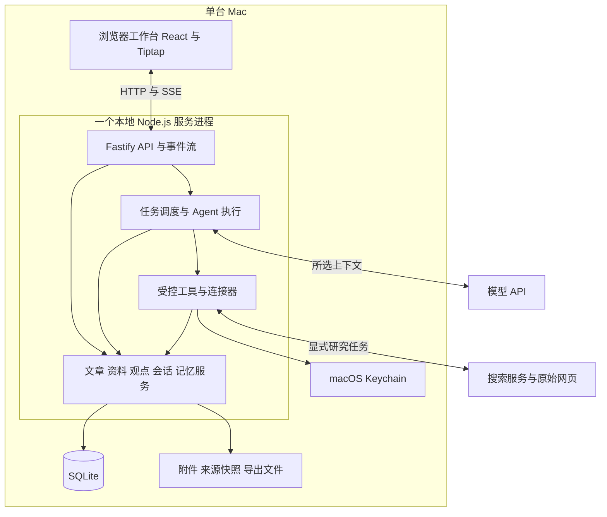

# Inkling 单台 Mac 本地运行架构

C02 实现更新（2026-11-17）：文章存储经 POC 选定 JSON 正文 + SQLite / better-sqlite3，初期不加 ORM。独占连接、恢复副本和保存协议以 [DEC-0004](../decisions/0004-article-storage-and-revisions.md)及 [文章持久化规格](../../openspec/specs/article-persistence/spec.md)、[修订规格](../../openspec/specs/article-revisions/spec.md)、[工作空间规格](../../openspec/specs/local-workspace-access/spec.md)为准；上述能力已通过产品验收，下文其他模块仍是架构提案。

C03 在同一个 SQLite 工作空间中新增文章库元数据及索引。每篇文章保留自己的正文修订、浏览器恢复副本和编辑位置，切稿前先处理未确认输入。[文章库规格](../../openspec/specs/article-library/spec.md)

设计日期：2026-11-16。状态：整体架构提案；本地工作台已交付，文章存储设计 POC 已完成，其余能力按 change 验证。作者已明确 MVP 在单台 Mac 本地运行，内容上云与多端协作放到后续阶段。本文作为当前 MVP 架构入口，细化[协作设计](../product/thinking-partner-product-design.md)的实现边界。

范围与存储更新：当前功能以[V1 完整范围](../product/v1-scope.md)为准，首版已包含作者风格、跨文章记忆与一个真实博客的发布和更新。文件与 SQLite 对照后，C02 选定 JSON 正文与 SQLite；下文表结构和备份仍是 V1 整体提案，具体已实现范围以 DEC-0004 和 Living Spec 为准。

工程基础更新：bootstrap-local-workbench 采用 Node 22.22.2、React/Tiptap、Fastify 与共享健康契约，实际入口见[本地运行](../engineering/local-development.md)。这只实现临时编辑和工程基础，不表示下文的存储、Agent、恢复与发布提案已实现。

## 部署目标和工作假设

首版服务一位作者、一个本地工作空间。浏览器默认打开稿纸，按需展开文章库和闻一。Mac 上的 Node.js 服务负责业务、模型调用和任务调度，本地存储保存内容。完整 V1 支持记录、讨论、编辑、研究、积累个人知识，并向首个博客交付文章。[写作台交互设计](../product/v1-scope.md#默认交互与入口)

当前按允许调用远程模型 API 和联网检索设计。应用运行位置、内容保存位置与模型推理位置分别配置。调用远程模型时，选中的正文、材料片段与会话上下文会发送给对应提供方；界面应显示提供方和当前资料范围。模型是否也必须离线运行仍待确认。

离线状态支持查看本地资料、记录灵感、编辑、版本恢复和导出。模型调用与网页检索显示可用状态，用户可取消等待。日后接入本地模型时，工具调用、中文表达、上下文容量与机器内存需要重新验收。

## 交付形态

MVP 建议使用本地 Web 应用。首次开发和自用通过脚本启动服务，自动打开本机地址。Vite 用于开发与构建，日常运行由 Fastify 提供构建后的静态资源和 API，前后端同源。

| 路线 | 适合的阶段 | 工作量与取舍 |
| --- | --- | --- |
| 浏览器加本地 Node 服务 | 当前 MVP | 前后端均使用 TypeScript，适合快速验证写作体验；用户需要启动服务 |
| Electron 桌面应用 | 需要独立窗口、托盘、安装包时 | 可复用 Web UI 和 Node 模块，需要处理主进程、renderer 隔离、打包、签名与更新 |
| Tauri 桌面应用 | 后续有明确体积或原生集成需求时评估 | 需要额外验证 Rust 宿主、WebView 和 Node 运行时或 sidecar 的组合 |

Electron 的原生权限和 renderer 隔离需要专门设计，增加桌面外壳应有独立验收。[Electron 安全说明](https://www.electronjs.org/docs/latest/tutorial/security)

首版交付要求是提供可重复的安装说明、一条启动命令和清晰的停止方式。安装脚本与命令名在实现阶段确定。双击安装包、开机启动和自动升级放到桌面交付阶段。

## 进程与模块



API、后台任务和存储在同一服务进程中，模块之间通过函数与契约调用。网络请求使用异步 I/O，数据库事务保持短小。大量 PDF 解析等 CPU 工作出现时再移入 worker thread 或受控子进程。

第一版同时执行一个主动 Agent 任务，其余进入持久队列。作者编辑和确定性查询随时可用。等待作者答复的任务释放执行槽位，恢复时重新排队。这个并发值是可调的起步策略。

启动器使用固定本机服务地址与身份探测实现单实例：成功独占监听端口后才初始化数据库迁移和调度；已存在合法 Inkling 服务时打开现有页面；端口被其他服务占用时给出错误。首版只支持一个默认实例，不能通过自动改端口启动第二个服务写入同一工作空间。端口占用与双启动竞态需要测试。

服务绑定 `127.0.0.1`。开发模式的 Vite 代理转发到本地后端，发行运行只启动构建后的服务。关闭浏览器不会发送取消指令，服务停止和 Mac 休眠则影响任务执行。

## 技术选择及成熟度

| 位置 | 当前建议 | 选择依据与待验证项 |
| --- | --- | --- |
| 语言与组织 | TypeScript、pnpm workspace | 前后端共享契约，先保持少量模块 |
| Node | Node.js 26 LTS 候选 | 官方当前列为 LTS；SQLite 原生驱动和 Agent SDK 在目标 Mac 上验证后锁定版本 |
| 前端 | React、Vite、Tailwind CSS、shadcn/ui | 延续工作台方向；状态和任务通过 API 获取 |
| 编辑器 | Tiptap／ProseMirror JSON | 保留结构、节点 ID、引用和代码块；中文输入法与导出需实测 |
| HTTP 与事件 | Fastify、HTTP 命令、SSE | 命令与任务生命周期分离，事件可重连 |
| 数据 | C02 选定 SQLite、better-sqlite3、参数化 SQL | 事务、迁移、独占连接与故障恢复已实现并通过 Mac/Linux 验收；暂不引入 ORM |
| 文件 | 应用数据目录中的不可变附件与来源快照 | 数据库保存逻辑 ID、相对路径、hash 和大小 |
| Agent | 优先验证 Pi AI 加 agent-core | 适合可插话的单 Agent；由产品保存业务状态，恢复语义见后文 |
| 替代运行时 | LangGraph.js | 当流程级自动恢复是必要条件时，以相同任务对照评估 |
| 输入输出约束 | Zod／JSON Schema | 校验工具参数、候选成果和 API 数据 |
| 凭据 | macOS Keychain，开发期允许进程环境变量 | Node 接入库或本地桥接方式在 POC 中验证 |
| 检索 | 结构化筛选、中文分词后的 FTS5 与短词兜底 | 先验证术语、英文标识符、短中文词和混合文本 |
| 验证 | Vitest、Playwright、结构化本地日志 | 覆盖业务事务、恢复、中文编辑与正常入口 |

截至本次核验，Node 26 和 Node 24 均列在 LTS 范围。先测试 26 的依赖兼容性，遇到明确阻塞再记录选择 24 的理由。[Node 发布状态](https://nodejs.org/en/about/previous-releases)

Tiptap 官方建议使用 JSON 持久化编辑器结构。Inkling 采用 JSON 主稿，Markdown 作为导入导出格式。自定义引用节点的往返转换规则由产品实现。[Tiptap 持久化说明](https://tiptap.dev/docs/editor/core-concepts/persistence)

## 数据目录与保存边界

建议默认目录如下，均属于本机用户。工作空间不随代码仓库移动。

```text
~/Library/Application Support/Inkling/
  config.json                  非敏感配置与工作空间 ID
  workspaces/<workspace-id>/
    inkling.sqlite             业务数据、任务与操作记录
    assets/<hash>              图片与导入附件
    sources/<hash>             原始材料及可保存的正文快照
    exports/                   导出结果
    backups/                   可恢复备份包
    tmp/                       解析与导出的临时文件
~/Library/Logs/Inkling/         有轮转与容量限制的运行日志
macOS Keychain                模型和连接器凭据
```

SQLite 启用外键、WAL、适当的 busy timeout，并优先以 `synchronous=FULL` 验证保存体验与性能。数据库写入经统一存储模块完成，网络调用与模型生成期间不持有事务。磁盘满或提交失败时界面保持未保存状态，保留可导出的编辑内容。

WAL 适用于同机访问，并涉及数据库旁的 WAL 文件；其并发能力仍有单写者约束。活动工作空间存放在本地应用数据目录，云备份日后通过完整备份包实现。[SQLite WAL](https://www.sqlite.org/wal.html)

附件先写入临时文件、校验并原子移动到内容寻址路径，再提交数据库引用。崩溃可能留下待清理孤立文件。垃圾回收按引用和宽限期处理，运行或备份中的文件保持保留。主稿保存只在数据库事务成功后确认。

文章、证据、会话和已确认记忆由业务数据管理。搜索索引、摘要和预览属于可重建数据。数据库记录逻辑附件 ID，绝对磁盘路径仅由存储实现解析。

## 最小领域模型

| 对象 | 职责 |
| --- | --- |
| Workspace / Project | 本地工作空间与正在探索的问题，项目可以暂时没有文章 |
| Note / Observation | 灵感、个人观察和实践背景，记录原始输入和来源类型 |
| Claim / ClaimRevision | 作者或模型提出的判断，记录版本、条件、确认状态 |
| SourceSnapshot / Evidence / ClaimAssessment | 原始资料、定位片段，以及片段对某版论断的支持或冲突关系 |
| Article / ArticleRevision / ClaimOccurrence | JSON 正文、不可变版本、某版论断在具体段落中的出现位置 |
| Proposal | 候选改动，包含文章基线、节点和预期内容 hash |
| Session / Message | 讨论记录、作者输入和可见回复，与正文独立保存 |
| Run / Step / Operation / RunEvent | 一次任务、执行边界、工具结果、预算和事件序号 |
| MemoryCandidate / MemoryRevision | 待确认和已确认的经验、观点、术语与表达偏好 |

关系用普通表和外键表达。论断文本、正文段落或引用范围改变后，相应评估标为待复核。模型建议成为作者观点需要明确操作，事实审阅状态单独保存。

所有主要记录使用稳定 ID、schema 版本和必要的 workspace 引用。首次实现按实际任务建表，避免先完成全部未来对象。多端场景所需的权限、冲突和删除同步，在对应阶段设计。

## 编辑与自动保存

浏览器保存请求携带 `document_id / base_revision / client_mutation_id / content_json`。服务端在事务中比较版本、保存不可变修订、推进 head 并记录事件。请求重试使用同一个 mutation ID，响应丢失后能找回原结果。

输入期间进行短延迟合并保存；后台确认前显示“保存中”，失败时显示“未保存”。IndexedDB 保存待提交草稿与 mutation ID，刷新后先查询服务端状态再补交，防止重复或覆盖。浏览器本地草稿仅作为故障恢复副本，清理浏览器数据可能使未同步内容丢失。

接受 AI 建议前先同步当前编辑并检查候选基线。冲突时保留作者稿和候选，提供重新生成或人工合并。用户继续输入时，旧保存响应只能更新已确认版本与保存状态，不能用旧正文替换当前编辑器内容。两个标签页同时编辑也执行相同的版本比较。

模型流式输出进入候选预览。正文变更通过作者接受或明确的编辑命令提交。导出使用指定的已保存修订，代码、引用和图片路径有明确转换结果。

## Agent 内核与任务执行

当前范围使 Pi AI 加 agent-core 成为优先验证路线。公开接口提供工具执行、事件流和上下文转换；其中 steering、follow-up 与取消的接入需要在固定版本上测试。它的内存状态由 Inkling 的任务和成果记录补充持久化。[Pi agent-core](https://github.com/earendil-works/pi/blob/v1.5.2/packages/agent/README.md)

LangGraph 保留为同任务对照，重点比较检查点、人工等待和恢复。其 checkpointer 和 store 有不同职责，采用后仍须处理业务事务与图状态的一致性。[LangGraph Persistence](https://docs.langchain.com/oss/javascript/langgraph/persistence)

POC 后选择一个运行时。上层只依赖启动、事件、取消和继续任务的接口，文章和证据不引用 SDK 专属类型。

一次任务按以下顺序执行。

1. 接收用户命令，在事务中保存消息、Run 和接收事件，然后返回 Run ID。
2. 调度器领取任务，固定文章基线、Skill 内容 hash、模型配置和上下文引用。
3. 根据问题、相关材料、已确认记忆和必要聊天构建上下文，读取取消和预算状态。
4. 运行时调用模型，产出工具请求、待答问题或候选成果。
5. 工具入口校验参数和任务范围，先记录操作 ID，再执行并保存结果。
6. 校验成果并保存，或携带新资料进入下一轮，或等待作者答复。
7. 保存终态、成果 ID、实际用量和停止原因，界面从持久事件获得确认。

只在需要探索资料或迭代解决问题时循环。普通记录和保存直接调用业务服务，大纲和局部改写通常走短路径。内部候选写入通过操作 ID 去重。

起步配置为全局一个活动 Run，研究任务最多 8 次模型调用、16 次工具尝试和 5 分钟活跃执行。另设 token 与费用预算。重试和格式修复计入总量，连续无进展时提前交付缺口。具体限额在真实任务测试中调整。

SDK 重试应可观察且受预算控制。每次调用先保存预留，成功后结算；网络返回不明时保留未知记录。取消停止后续步骤，迟到响应不会继续触发新工具，也不能自动覆盖正文。作者插话先保存，再在执行边界处理。

## 会话 记忆 Skills 与 MCP

Session 维护作者看见的对话。Run 维护一次任务。项目知识维护问题、观察、论断和资料，作者记忆维护经确认的经验与偏好。上下文由这些持久记录按任务重建，摘要保留引用入口。

首版内置探索问题、检查论证、组织大纲、协作表达四类 Skills。使用 `SKILL.md` 组织方法和按需资料，Run 固定内容 hash。Skill 方法由产品维护，工具权限由程序实施。

原生工具首先提供读取文章、查找笔记、读取证据、保存候选、搜索和获取网页。MCP Client 在遇到具体外部资料服务需求时接入统一工具入口。subagent、对外 MCP Server 和并行研究待单 Agent 验证暴露需求后引入。

长期记忆更新由作者确认，删除或撤回后，后续运行及恢复任务重新构建上下文，清理相关派生缓存。保存可解释的讨论总结和执行事实，不依赖模型隐藏推理。

## 中断 恢复与 Mac 生命周期

推荐 Run 状态为 `queued / running / waiting_user / interrupted / succeeded / failed / cancelled / limit_reached`。本地原子保存操作若响应未知，可按 operation ID 查询结果。外部搜索和模型调用响应未知时记录用量或结果不确定，恢复界面说明可能重新调用。

| 场景 | 首版行为 |
| --- | --- |
| 浏览器关闭或 SSE 断线 | 服务继续执行；重新打开后读快照与事件 |
| 模型调用暂时失败 | 在预算内有限重试，已有编辑和材料仍可用 |
| Mac 休眠后唤醒 | 校验连接和期限，保留已完成步骤；超时任务进入可处理状态 |
| 服务正常退出 | 停止接单，取消在途请求，保存已完成边界，标记未完成任务 |
| 服务崩溃或电脑重启 | 已接收任务从数据库找回，原运行中任务标为 interrupted |
| 作者点击继续 | 在原 Run 下创建新的执行 attempt，从已保存成果重建上下文，沿用剩余预算 |
| 升级后旧任务不兼容 | 保留成果与原任务记录，提示重新发起关联任务 |

首版恢复承诺是已提交内容与执行边界可找回，作者可继续任务。继续时模型计划可能重新生成，未记录结果的请求可能再次计费。精确恢复任意执行点需要额外运行时能力与测试，应在选择 LangGraph 等方案时单独评估。

旧 attempt 的异步结果由 attempt ID 与 Run 状态检查拦截。继续、取消和等待输入的答复均采用幂等命令。任务预算保存在业务库，重新打开应用不会重置已消耗额度。

## 本地 API 与凭据

| 命令 | 含义 |
| --- | --- |
| `POST /api/projects` | 创建问题或文章项目 |
| `POST /api/sessions/:id/turns` | 保存输入与 Run，返回受理记录 |
| `PUT /api/articles/:id/content` | 按版本和 mutation ID 保存正文 |
| `POST /api/proposals/:id/accept` | 校验基线并接受候选 |
| `GET /api/runs/:id` 与 `/events` | 获取快照及有序 SSE 事件 |
| `POST /api/runs/:id/cancel` 与 `/continue` | 保存取消或继续命令 |
| `POST /api/exports` | 从已保存修订生成 Markdown 和附件 |

启动器生成一次性短期启动凭证，通过 URL fragment 带给本机页面，在校验同源的交换接口换取 HttpOnly、SameSite 会话 Cookie。交换后立即清理 fragment。服务对 Host、Origin、会话与写请求 CSRF token 做校验，拒绝跨源资源读取和写入；开发 Origin 单独配置。单用户使用仍需防止其他网页操作本机服务。

模型密钥由后端向 Keychain 获取，日志与数据库仅保留凭据标识。导入文件经用户选择并复制到受控目录。网页抓取验证目标地址及每次重定向，资料中的文字不能扩大工具访问范围。服务内不向模型注册任意 shell 工具。

## 备份 升级与恢复

备份包含数据库、被引用的附件与来源快照、schema 和应用版本清单及校验值。首版备份期间暂停写入与任务调度，等待当前本地提交结束，再生成 SQLite 一致性快照并复制引用文件；远程调用迟到结果在写入屏障之后处理。备份先写临时包，完成校验后再标记可恢复。

数据库快照使用驱动支持的 Online Backup API 或经过验证的 `VACUUM INTO` 路径。运行中的数据库不能仅靠复制主文件获得完整备份。[SQLite Backup API](https://www.sqlite.org/backup.html)

恢复在服务停写时完成，先校验版本和附件 hash，再恢复到新目录并验证，成功后切换。密钥需要重新配置或由本机 Keychain 读取。MVP 提供手动备份与恢复，迁移前生成自动备份，避免备份机制只有说明而没有可执行入口。

升级先检查 schema 兼容性，再备份和执行事务迁移。旧应用无法读取新 schema 时明确拒绝写入。数据目录独立于代码和应用文件，卸载与删除工作空间分别处理。

## 面向后续上云的边界

| 当前边界 | 后续演进 |
| --- | --- |
| 稳定实体 ID、内容版本和来源引用 | 支持迁移、增量同步与冲突识别 |
| Repository 与事务入口 | 存储需要时迁移到 PostgreSQL，并复验事务语义 |
| AssetStore 的逻辑 ID 与流式读写 | 文件可转入对象存储 |
| 独立应用服务 | 新增桌面壳或云端 API 时复用业务规则 |
| 版本比较与幂等命令 | 为多设备冲突处理提供基础 |
| 导出与备份包 | 支持作者迁移和受控云备份 |

后续按云备份、个人多设备同步、多人协作分别定义需求。个人离线编辑需要变更日志、冲突策略与删除同步，多人实时协作还需要身份权限和文档合并协议。这些能力届时有独立实现与迁移成本。

## 实施顺序和验收

| 阶段 | 可运行的交付 | 通过条件 |
| --- | --- | --- |
| 兼容性 POC | 目标 Mac 的 Node、SQLite、编辑器与 Pi 最小调用；LangGraph 同任务对照 | 原生依赖安装成功，工具、取消、结构化产物和恢复方案可用 |
| 本地写作基础 | 启动、项目、编辑、自动保存、版本、导出、备份恢复 | 刷新、重复保存、双标签冲突、磁盘失败和恢复均有确定结果 |
| 思考协作 | 一个主 Agent、四类 Skills、候选与采纳、上下文和预算 | 能从模糊想法得到作者认可的结构，编辑不被迟到结果覆盖 |
| 资料与论证 | 定向检索、原文定位、观点和条件关联、最小记忆 | 来源可找回，中文与技术术语可检索，撤回资料后不再注入 |
| 本机使用验收 | 完整文章与连续项目 | 浏览器关闭、Mac 休眠、进程中断、升级和备份恢复实测通过 |

首轮测试记录目标 Mac 的架构、macOS 版本、依赖锁文件、实际 SQLite 版本、内存和任务用量。Apple Silicon 与 Intel 的覆盖范围按实际设备验证后公布。

以上是架构验证步骤，完整首版还包括风格档案、跨文章积累、真实博客发布与更新，按[V1 实施顺序](../product/v1-scope.md#同一版本内的实施顺序)交付。下一步实施从本地写作基础、存储与运行时 POC 开始，具体框架和版本以结果形成新的决策记录。
