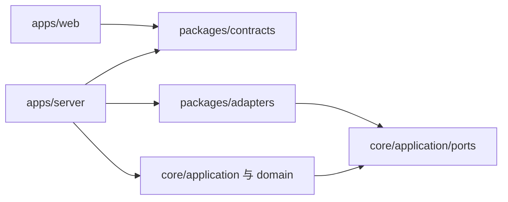

# 代码架构规范

更新日期：2026-11-16。状态：开发约定，目录按真实实现逐步创建。部署与运行时提案见[本地架构](../architecture/local-macos-mvp.md)。

## 模块化单体

首版一个本地服务进程、一个 Web UI。建议按以下物理边界组织 TypeScript workspace；空模块不预建，每个公共接口只有实际使用者出现时才提取。

```text
apps/web/                React 编辑器、Chat、面板与前端状态
apps/server/             HTTP/SSE、启动关闭与依赖装配
packages/core/           domain/ 业务规则；application/ 用例与 ports/
packages/contracts/      公开 API、事件、候选成果的 schema 与类型
packages/adapters/       存储、模型运行时、搜索、Keychain、发布连接器
packages/test-support/   产生复用需求后再提取夹具和可控替身
```

`core/domain` 不依赖 React、HTTP、文件系统、数据库或 Agent SDK。`core/application` 通过 ports 调用外部能力。adapters 实现 ports，server 负责装配；web 只通过 contracts 和 HTTP/SSE 使用后端，不导入 core 实现或 adapters。



箭头表示允许的源码依赖。domain 不依赖 application；contracts 不依赖其他业务包。application 输出领域结果，由 HTTP 映射到公开契约。工具调用也进入同一用例，不能直接绕过业务规则写文件或改库。

## 必须守住的边界

- 正文只有一种权威表示。Markdown 导出、搜索索引、预览、聊天摘要均为派生信息；存储方案经 POC 决定。
- 文章版本、候选建议、会话、Run 与记忆是不同实体，使用稳定 ID。聊天内容不能充当任务状态或正文数据库。
- 业务服务集中校验版本基线、幂等键与确认状态。UI 按钮禁用不能替代服务端约束。
- 模型输出经过 schema 与业务校验，只能产生候选或受控工具请求；作者已确认的内容和外部资料不混为一类。
- SDK 类型停留在 adapter。产品任务、错误和事件使用自己的窄接口；首版只选一个运行时实现。
- 文件/数据库写入通过统一 Repository 或存储用例。定义原子提交、恢复与失败返回语义后再选实现，不以接口遮掩不同存储保证。
- 搜索、网络、模型和发布都支持取消、超时与有界重试。不可取消的迟到结果必须检查 attempt 与任务终态。
- 本地保存、远端草稿、公开发布、更新文章是不同操作；副作用使用稳定 operation ID，结果未知时先核对，不能盲重试。

## 依赖与数据契约

只导入包的公开入口；禁止跨包相对路径钻入内部模块、循环依赖、全局可变容器与通用大杂烩 utils。小项目先在包内按 article、source、session、run、memory、publishing 等职责组织，出现真实边界再拆包。

新增依赖在 design 写出用途、已有替代、运行位置与兼容验证。lockfile 必须入库；安装命令、Node 与包管理器版本在首条工程 change 锁定。禁止顺手全量升级依赖。

输入使用 `unknown` 并在边界解析；公开错误包含稳定 code、可读信息与可恢复动作。SSE 事件带 run ID、事件序号与类型，连接状态不充当业务完成状态。日志包含关联 ID 与耗时，不记录密钥或默认完整稿件。

业务时间、ID、外部调用通过可替换窄依赖提供，以便验证超时、冲突、取消与恢复。替身只替代外部边界；保存协议验收使用真实选定存储，UI 验收经过真实服务入口。

## 架构变更与执行检查

普通局部实现记在 change/design；改变模块职责、权威格式、恢复保证、模型/存储框架时补 ADR。ADR 记录取舍和重新评估条件，不把候选写成已实现。

第一条工程 change 应把上述导入限制落实为 ESLint restricted imports 或等价边界检查，并有一个故意违规的负例证明能失败。循环依赖检查、TypeScript strict、构建与契约测试接入相同本地和 CI 命令；工具选择以小验证决定，不同时引入多套检查器。
