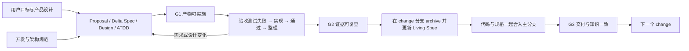

# Inkling 开发 Harness

更新日期：2026-11-16。状态：个人开发工作约定与初始工具骨架。本文约束开发 Inkling 的 coding agent；产品内写作 Agent 的运行时见[本地架构](../architecture/local-macos-mvp.md)，两者独立。

## 目标与组成

每次只推进一个 change，使需求、验收、实现、验证与当前规格保持一致。G1/G2/G3 保留必要产物与检查，取消 IO、SA、VL 等角色签署；同一作者和同一个 coding agent 可以完成各阶段。自动检查不等于需求正确或测试充分。



Harness 由六部分组成：规则、上下文入口、OpenSpec 产物依赖、ATDD 执行循环、验证证据、归档与反馈。Skills 是操作入口，检查脚本是可重复的结构检查，Git 是版本与合入依据；不增加第二套任务数据库。

## 知识权威与目录

| 内容 | 唯一主要维护位置 |
| --- | --- |
| 为什么做、完整 V1 范围 | `docs/product/` |
| 开发方法与规则 | 本目录；根 `AGENTS.md` 只提供入口与关键约束 |
| 当前已交付行为 | `openspec/specs/<capability>/spec.md`，即 Living Spec |
| 当前要改变什么 | `openspec/changes/<change-id>/` 的 delta 与设计 |
| 执行方法 | `.agents/skills/inkling-*/SKILL.md`，引用本目录规则 |
| 过程证据 | 当前 change 的 `verification.md`、`evidence.json`、`evidence/` |
| 已完成变更历史 | `openspec/changes/archive/<date>-<change-id>/` |
| 技术重大取舍 | `docs/decisions/`；架构说明引用决策与已实现规格 |

现有产品文档是目标与提案，不批量转换成“已实现”的 Living Spec。首次建设 Harness 是一次引导配置，没有预写产品规格；后续已交付行为通过各自的 change 进入 Living Spec。后续 Harness 自身的行为变化也走 change；文字修正可以用轻量路径。

每个正常行为 change 包含：

```text
openspec/changes/<change-id>/
  .openspec.yaml
  proposal.md
  specs/<capability>/spec.md
  design.md
  acceptance.md
  tasks.md
  verification.md
  evidence.json
  evidence/                 经脱敏的精简日志和必要截图
```

`openspec/config.yaml` 指定 `inkling-atdd` schema。依赖为 proposal → specs → design → acceptance → tasks；verification 在实现后填写，不成为开始实现的先决条件。OpenSpec 的 artifact complete 只说明文件生成，不说明测试通过。

## 串行 change 与 Git

默认分支沿用当前仓库 `master`，开发分支为 `codex/<change-id>`。同一时刻只允许一个未归档 change；未来想法留在[开发顺序](#建议的首批-change)，不要先批量创建 changes。每次开始读取 Git 状态和 `openspec list --json`，恢复未完成工作优先。

单 change 可以有多个提交、多个测试切片。默认在同一工作区推进，不开并行功能 worktree。结构检查只看当前工作区的 active change，无法发现其他工作区或他人分支；串行约定仍需执行者遵守。

三个动作分别是：

1. **规格合并**：将 delta 的 ADDED / MODIFIED / REMOVED / RENAMED 应用到 Living Spec。
2. **OpenSpec archive**：可在一次操作中完成规格合并，并把 change 移入历史目录。
3. **Git merge**：把代码、测试、规格和归档记录一起合入主分支。

默认顺序是 G2 → 在 change 分支 archive（包含规格合并）→ 验证归档结果 → Git merge → G3。主分支只接收完整闭环。不要先在主分支留下“代码已合入、规格以后补”的窗口，也不要独立手写一套 Living Spec 来绕开 OpenSpec。

Git merge 可使用本地合并或 GitHub PR，个人项目不要求自我审批 PR。commit、push、merge 按当前用户授权执行；没有发布授权时，完成可审阅结果并说明等待的外部动作，不冒充 G3 已完成。已明确授权不重复索要 G1/G2/G3 签署。

## 三个检查点

| 检查点 | 必要产物与检查 | 不满足时 |
| --- | --- | --- |
| G1 可实施 | proposal 范围与非目标；合法 delta；design 边界、数据与失败路径；acceptance 场景、测试层和夹具；tasks 按验收切片；结构检查与 OpenSpec strict validate | 修正对应产物；只询问真正影响行为且不能合理推定的问题 |
| G2 可合入 | tasks 完成；验收与必要回归通过；实际执行命令、退出码、日志；场景到测试映射；代码审阅发现与处理；待合入内容的证据指纹 | 修复后重跑受影响检查；缺环境记 blocked/未执行，不记通过 |
| G3 已收口 | delta 已归档、Living Spec 与实际行为一致、Git 合并已完成；知识索引与架构说明已更新；无 active change；合入版本必需 CI/本地集成检查通过 | 继续处理当前 change，下一 change 不启动 |

G1/G2/G3 是检查结论，不是签字文件。一个 `verification.md` 汇总证据与结论，另用 `evidence.json` 供结构检查。没有要求时不增加 g1/g2/g3 三份记录、审批人字段或跨角色交接。

设计评审、测试覆盖评审和归档语义检查由 agent/作者根据产物完成；当前脚本仅检查文件、映射、任务、证据路径与 hash。它不会判断测试断言是否正确，也不能鉴别伪造日志。结构检查成功只能写“结构检查通过”。

## 单次实现循环与恢复

开始切片前读取当前 delta、acceptance、design、tasks 和涉及模块，不把全部行业调研塞入上下文。每个场景保留稳定 ID，例如 `ARTICLE-SAVE-001`，写入 Scenario 标题、acceptance 表、测试名称和证据。

先运行新验收测试，记录因行为缺失而失败的结果；再做最小实现，运行同一测试，补必要单元与集成回归；整理后再次验证。命令拼错、依赖未安装、超时或测试未发现都不算有效 Red。行为原已满足时记录 baseline-pass，不制造失败。

每个切片结束更新 tasks；中断时在 verification 的进度段写明当前切片、最后运行命令、结果、未解问题和下一步。恢复时重新检查工作区与证据指纹，不依赖聊天记忆。实现偏离契约时先更新 delta / design / acceptance，再继续测试。

同一失败连续三次没有新信息时停止盲目重试，缩小复现并记录假设；只有外部信息或授权确实缺失时才问用户。不得删除测试、放宽断言或把失败改写成 skip 来推动流程。

## 可用命令与工具版本

本次验证基线为本机 OpenSpec **1.16.1**，Node **22.22.1**（Harness 脚本不依赖第三方包）。这是开发工具基线，不冻结 Inkling 产品运行时版本。官方在线文档已出现 2.x 入口，不能把不同版本的 skills 名称和 CLI 行为混用。升级作为独立 tooling change，在临时夹具中验证 schema、status、validate、archive 后更新基线。

```bash
OPENSPEC_TELEMETRY=0 openspec list --json
node scripts/harness/check.mjs
# 当前无 active change 时再创建
OPENSPEC_TELEMETRY=0 openspec new change <change-id> --schema inkling-atdd
OPENSPEC_TELEMETRY=0 openspec instructions proposal --change <change-id>
# 依次使用 specs / design / acceptance / tasks instructions
node scripts/harness/check.mjs <change-id> --stage plan
OPENSPEC_TELEMETRY=0 openspec validate <change-id> --strict --no-interactive
# 完成 ATDD 与验证后
node scripts/harness/check.mjs <change-id> --stage verify
# 在已通过 G2 的 change 分支中执行
OPENSPEC_TELEMETRY=0 openspec archive <change-id> --yes
node scripts/harness/check.mjs <date>-<change-id> --stage archived
OPENSPEC_TELEMETRY=0 openspec validate --specs --strict --no-interactive
OPENSPEC_TELEMETRY=0 openspec validate --archived --strict --no-interactive
node scripts/harness/docs-check.mjs
```

上述命令中 `<...>` 为参数占位。归档命令在 G2 之后使用：`--yes` 会跳过交互确认，**不是门禁**。禁止通过 `--no-validate` 绕过失败。正常行为 change 不使用 `--skip-specs`。CLI 没有替我们执行 Git merge。

Harness 自身的回归命令为 `node --test scripts/harness/check.test.mjs` 和 `OPENSPEC_TELEMETRY=0 node scripts/harness/openspec-smoke.mjs`；后者只在临时目录验证真实 CLI，不创建本项目 change。初始化结果见[验证记录](../validation/harness-bootstrap.md)。当前未安装 Git hooks，检查需按流程显式执行；bootstrap-local-workbench 已接入 CI 必需检查。

无行为改变的文字/配置修正允许轻量路径：明确原因、影响与验证，省略无意义的 Red；不创建虚构验收。仅此类 change 可按 CLI 的 `skip_specs: true` 机制处理，并在 proposal 与验证报告说明。当前 `inkling-atdd` schema/checker 面向有行为契约的 change；纯文字更正直接按本段评审提交，不创建占位 delta 来取悦工具。

## Skills 与参考流程的取舍

项目提供四个薄入口：`inkling-change-plan`、`inkling-atdd-apply`、`inkling-change-verify`、`inkling-change-close`。它们使用真实 CLI，引用这里的规则，不复制 OpenSpec 自带技能，不依赖未安装的 Superpowers，不自动启动 subagent。需要独立评审时可以换会话；没有人审或独立 agent 就如实标为自检。

参考材料来自用户指定的 `ai4se-baseline/.agents/skills/`（源工作区：`/Users/xcg/Workspace/OOCL/AFS-2026-Bootcamp/sdd/ai4se-baseline`），仅借鉴方法，未复制其脚本与 vendor 依赖：

| 参考 | 保留 | 个人版调整 |
| --- | --- | --- |
| sdd-govern | 规则集中、AGENTS 入口 | 使用既有 docs/engineering，不引入另一套 knowledge/rules 树 |
| sdd-atdd-design / sdd-task-plan | 场景先于实现、规格与任务对齐 | 单份 acceptance，保留必要服务集成层；不强制会议或逐项确认 |
| sdd-atdd-apply | 按切片 Red → Green → Refactor | 允许 baseline-pass 与无行为文字变更；不做形式化补测 |
| sdd-local-verify-report | 实际命令、退出码、失败不冒充通过 | 单份报告加机器可读索引；风险相关检查才运行 |
| sdd-g1/g2/g3-decision-record | 三个检查点的含义 | 无角色签署，不生成三份审批文档 |
| sdd-living-merge | OpenSpec 是 Living Spec 权威 | 归档与 Git merge 收在一个 change；知识更新真实检查，不接 no-op 占位脚本 |
| sdd-agent-evalset | 区分确定性测试与模型效果评估 | 真实模型评测按受影响能力选择，小样本记录限制 |

## 建议的首批 change

此表是候选顺序，不是已创建的 changes。每个 change 都形成可运行且可验收的切片，完成后再细化下一项。

1. `bootstrap-local-workbench`：锁定开发依赖、建立模块与检查命令，一条命令启动空白编辑器及服务健康检查。
2. `persist-article-revisions`：文件与 SQLite POC 后确定权威格式，完成保存、冲突提示、版本恢复的第一条闭环。
3. `discuss-article-context`：真实模型适配、文章/选区上下文、会话、取消和预算。
4. `review-and-apply-proposals`：候选修改、差异、基线检查、接受与撤回。
5. 后续按[V1 批次](../product/v1-scope.md#同一版本内的实施顺序)逐项细化资料研究、风格记忆和博客交付。

## 已有能力与后续补齐

本次交付规则、schema、模板、四个本地 skill 和结构检查脚本。bootstrap-local-workbench 已建立 TypeScript、lint、依赖边界、API/进程/E2E 测试与 CI，实际命令见[本地运行](local-development.md)；远端 CI 结果仍按实际执行情况记录。G2 对任何已声明必需但缺失的检查均阻断。

官方依据：[OpenSpec CLI](https://openspec.dev/docs/cli) 的 archive、validate 与 schema 说明；本次命令兼容性以本机 `openspec --help` 和实际夹具验证为准。[OpenSpec 项目](https://github.com/Fission-AI/OpenSpec) 提供跨工具的规格与变更工作方式，Inkling 的串行与 ATDD 约束属于本项目约定。
