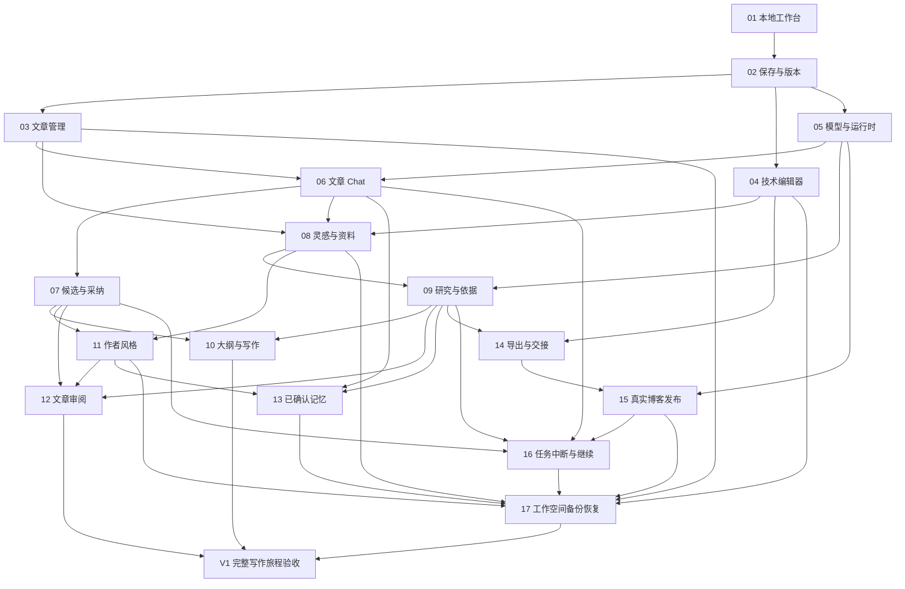

# V1 Change 路线图

更新日期：2026-11-17。状态：当前 C01 已交付，C02 已实现、验收、归档并合入主分支，G3 通过；C03 manage-article-library 已开始设计；C04–C17 尚未创建。范围依据为 [V1 功能范围](../product/v1-scope.md)，已实现行为以 `openspec/specs/` 为准。

## 数量与拆分原则

建议 V1 共 **17 条产品 change：2 条完成，1 条进行中，14 条待开发**。初始 Harness 配置不计入这 17 条；后续缺陷修复或确有必要的拆分可能增加数量，17 不是固定配额，也不是工期承诺。

每条 change 交付可使用、可验收的纵向能力，包含相应 UI、服务、存储、测试与文档。不会按前端、后端、测试分三条，也不会把整套 Agent 当作一条巨大 change。技术 POC 放在相关 change 的前置切片中，形成结论后再实现，影响后续边界的选择写入 ADR。

表中编号表示建议串行实施顺序；“直接依赖”是能力前置条件，不是并行开发指令。每次仅创建当前一条 change，通过验证、归档、合入后再创建下一条。未来项保存在本文，不预建 16 个 active change。

## Change 清单与依赖

| 编号 / change | 可使用的交付与验收重点 | 直接依赖 |
| --- | --- | --- |
| **C01 `bootstrap-local-workbench`**（完成） | 本地服务、临时中文编辑器、Chat 占位、健康检查、工程与 ATDD 入口。已归档并合入。 | 无 |
| **C02 `persist-article-revisions`**（完成） | 一篇真实稿件的创建/重开、自动保存、待提交稿恢复、命名版本、版本比较和恢复；保存重试与双标签冲突不覆盖新内容。确定正文与存储权威。 | C01 |
| **C03 `manage-article-library`**（进行中） | 多文章列表、创建、打开、重命名、标签、查找、归档、回收站与恢复，回到最近编辑位置。文章名称变化不改变 ID。 | C02 |
| **C04 `complete-technical-editor`** | 引用、链接、代码、图片、表格、公式、Mermaid 源码/预览、撤销重做、中文输入与粘贴；将文本/Markdown 作为可编辑稿导入，定义导出所需转换规则。 | C02 |
| **C05 `configure-agent-runtime`** | Pi/LangGraph 同任务 POC 后选一个运行时；模型配置、凭据保存、连通验证；最小 Run/事件持久化、工具边界、预算与取消，通过设置页真实调用验收。 | C02 |
| **C06 `discuss-article-context`** | 文章旁的真实持续 Chat；新讨论/历史、当前文章与选区引用、上下文范围、流式输出、停止、插话和失败重试。关闭页面后可找回讨论与任务状态。 | C03、C05 |
| **C07 `review-and-apply-proposals`** | 选区改写/续写产生候选，显示理由与差异；接受、拒绝、手改、撤回。采纳时校验版本和段落，旧建议不能覆盖新编辑。 | C06 |
| **C08 `capture-and-organize-sources`** | 独立灵感、笔记、资料项目；文本/Markdown、URL、文本 PDF、图片附件；来源快照、摘录批注、标签、关联及全文查找，可附加到 Chat。项目可没有文章。 | C03、C04、C06 |
| **C09 `research-and-trace-evidence`** | 带预算的定向搜索、资料比较、原文定位；问题/观察/论断/依据/适用条件/反例的轻量关系，显示缺口与过期评估。 | C05、C08 |
| **C10 `outline-and-compose-article`** | 从讨论/资料整理可编辑大纲，调整章节；分节写作、按请求起草全文、压缩/扩展，通过候选进入正文，保留未解决问题。 | C07、C09 |
| **C11 `manage-author-style-profiles`** | 导入作者样文，提炼并编辑风格说明；按文类配置、文章级选择、禁用表达与例外；生成和改写使用所选规则。 | C07、C08 |
| **C12 `review-article-arguments`** | 论证、引用支持度、术语一致性、重复和风格审阅；问题定位正文、查看依据、按项采纳或驳回。用人为设置的错误评测漏报与误报。 | C07、C09、C11 |
| **C13 `manage-confirmed-memory`** | 从讨论/资料/旧稿提炼待确认经验、观点、术语和偏好；确认后跨文章引用，能编辑、撤回、删除、导出，记录观点变化和出处。 | C06、C09、C11 |
| **C14 `export-article-bundles`** | 指定已保存版本的 Markdown、HTML 与附件包、格式预览；图片/公式/Mermaid/引用转换结果可检查，提供技术社区格式交接。 | C04、C09 |
| **C15 `publish-first-blog`** | 一个真实博客的配置、草稿、预览、确认发布与更新；确认绑定版本、附件、目标，结果未知先核对，避免重复创建。 | C05、C14；真实博客目标与测试授权 |
| **C16 `recover-agent-runs`** | 完整的中断/休眠/重启处理、等待作者与继续入口；按已保存步骤和成果恢复，沿用剩余预算，阻断旧 attempt 结果，核对未知外部操作。 | C06、C07、C09、C15 |
| **C17 `backup-and-restore-workspace`** | 包含文章、附件、版本、来源、会话、任务、风格、记忆及发布记录的一致备份；新目录恢复、校验、迁移前备份、版本不兼容拒绝写入、数据导出与日志入口。 | C03、C04、C08、C11、C13、C15、C16 |

C02 是最小持久化闭环；C03 扩展多文章管理。C04 导入的是主稿，C08 导入的是参考资料，两者身份与生命周期不同。C07 解决候选变更协议，C10 复用它实现长文结构，C12 复用它处理审阅问题。

C05 的最小工具是受控的模型连接验证与当前文章只读访问，不能任意访问文件或执行 shell。最小任务可从设置页查看执行状态与取消结果，不以只有 SDK 封装作为交付。原生业务工具逐步随 C07–C15 增加。

## 依赖关系

下面是主要路径；完整直接依赖以上表为准。各分支表示能力依赖，实际仍串行交付。

为保持首版“辅助个人思考”的主线，建议按 C01–C17 的编号推进。导出技术上可以在 C04/C09 后提前做；真正调整顺序时先更新本文，不把建议顺序误认为额外的代码依赖。

## C02：persist-article-revisions 的具体边界

这条 change 将当前“刷新即丢失”的页面变成能持续使用的单稿编辑器。它的目标不是接入某个数据库，而是明确稿件何时真正保存、何时发生冲突，以及如何找回旧内容。

### 作者能做什么

1. 首次进入时创建稿件，已有稿件时重开最近稿件；多文章导航由 C03 完成。
2. 输入标题和正文后自动保存，看到保存中、已保存、未保存或冲突状态。界面仅在服务端成功提交后确认已保存。
3. 关闭页面或重启服务后继续编辑。断网时仍可写，待提交稿使用本机恢复副本，重连先核对再补交。
4. 自动生成恢复点，手动命名重要版本，查看两版差异，将旧版恢复成新的当前版本。恢复不会抹掉中间历史。
5. 同时打开两个标签页时，旧版本提交被拒绝覆盖；保留两边内容，允许比较、复制或人工合并。

### 需要先定下来的契约

| 契约 | C02 内要做出的决定 |
| --- | --- |
| 正文权威表示 | 以当前 Tiptap 为起点验证带 schema 版本的结构化 JSON，覆盖格式往返和未来节点扩展；Markdown 是否只作为交换格式，以 POC/ADR 为准。不能两种主稿各自修改。 |
| 存储介质 | 文件快照与 SQLite 已完成同契约 POC，C02 设计选定 SQLite + JSON 正文，正式实现已通过 Mac/Linux 产品验收，见 [DEC-0004](../decisions/0004-article-storage-and-revisions.md)。 |
| 版本协议 | 稳定 article ID、base revision、mutation ID、内容校验；重试返回同一结果，重复响应不覆盖更晚的输入。 |
| 原子提交 | 正文、head 指针、版本记录与去重信息如何一致提交；文件方案也必须证明崩溃后的可判定结果，不能仅以 rename 一个文件代替完整验证。 |
| 恢复副本 | 待提交内容与 mutation ID 在本机的保存、核对和清理流程；浏览器副本不成为第二个主稿。 |
| 版本策略 | 保存合并时机、自动恢复点频率、命名版本保留规则及容量边界，在 change design 中明确，不为每个按键生成一份历史快照。 |
| 数据与本机写入口 | 工作空间独立于源码；单实例/写锁避免多服务同时写同一空间；在新增写 API 时落实会话、Origin/CSRF 与路径范围校验。 |

### 必须通过的验收

- 已确认保存的中文标题、正文和格式在刷新、服务重启后保持一致。
- 保存请求成功但响应丢失时，用相同 mutation ID 重试不会制造重复版本。
- 用户继续输入后收到旧保存响应，当前编辑内容保持不变，保存状态正确。
- 两个标签页基于同一版本保存，后提交者收到冲突，两个稿件内容均可找回。
- 磁盘满、权限错误、写入中断或损坏记录不会显示“已保存”，重启后能确定有效版本并保留可恢复输入。
- 离线输入后刷新/重连，先查明已提交结果，再恢复待提交稿，不能自动覆盖另一标签页的新稿。
- 命名、比较、恢复旧版本后形成新修订，原来的历史仍可查看。
- 恶意跨源写请求和越界文件路径被拒绝；第二个服务不能同时写同一空间。

不包含 AI、资料研究、发布、多端同步、多人协同或完整工作空间备份。C02 的恢复点只保护文章版本；全空间备份在 C17 统一覆盖所有实体。

## 基础保证逐步建立，不能留到最后补救

C02 起，新增本地写入都有明确保存与失败语义。C05 起，每个 Run 都有持久状态、取消、预算和有限重试；服务重启必须如实标为中断，不能假装任务仍正常执行。C06 起，会话独立于正文保存，断开浏览器不会丢掉已接收消息。C15 起，远端结果未知就核对，不盲目重发。

C16 增加的是从持久边界继续运行的完整体验和跨工具恢复验证；它不承担为前面丢失的数据补救的职责。C17 增加完整备份与迁移闭环；任何更早的破坏性 schema 迁移也必须先提供适用的安全备份，不能以 C17 未完成为由损坏已有稿件。

Skills 随能力交付：C06 探索、C09 研究、C10 大纲与表达、C11 风格应用、C12 审阅、C15 发布准备。它们是产品内写作方法，与仓库的开发 Skills 分开。MCP Client 仅在具体资料服务需要时作为相关 change 的适配器接入；subagent 和对外 MCP Server 不列为 V1 必须项。

## V1 范围覆盖与里程碑

| V1 范围 | 主要负责的 change |
| --- | --- |
| F-001 工作空间与文章管理 | C02、C03 |
| F-002 正文编辑 | C01、C02、C04、C14 |
| F-003 文档内 AI Chat | C05、C06、C08、C16 |
| F-004 灵感与资料 | C08 |
| F-005 研究与观点形成 | C09 |
| F-006 大纲与协作写作 | C07、C10 |
| F-007 作者风格 | C11 |
| F-008 审阅与修订 | C07、C12 |
| F-009 文章版本 | C02、C07 |
| F-010 个人知识与记忆 | C13 |
| F-011 导出与博客交付 | C14、C15 |
| F-012 本地运行与维护 | C01、C02、C05、C06、C16、C17 |

- C04 完成：可持续使用的本地技术文章编辑器。
- C07 完成：正文与 AI 讨论、候选修改形成第一条协作闭环。
- C12 完成：资料、论证、大纲、风格与审阅连接起来，能辅助表达个人洞见。
- C15 完成：跨文章个人积累与真实博客交付可用。
- C17 完成并通过整体验收：完整单机 V1。

整体验收是发布条件，不额外凑一条“验收 change”。沿用 V1 范围文档的 8 条端到端旅程，特别验证第二篇文章复用、真实博客更新、中断继续和新目录恢复。若发现行为缺口，修正当前 change；若已经归档则新开一条有具体缺陷范围的修复 change。没有真实博客验证、模型验证或恢复验证时，不能把 mock 通过算作完整 V1。

## 进入相应阶段前解决的问题

| 时机 | 决策/输入 | 对计划的影响 |
| --- | --- | --- |
| C02 | 文件与 SQLite POC、权威格式、保存策略 | 固定所有后续持久化的保证，完成前不铺开实体实现 |
| C05 | 模型提供方/凭据、允许发送的内容范围；Pi/LangGraph POC | 选一个运行时，真实调用与取消通过后才交付 Chat |
| C11 | 作者可使用的样文；无样文时支持手工风格规则 | 提炼规则需要真实样文验收，不影响规则编辑器本身 |
| C15 | 实际博客系统、账号权限与明确测试目标 | 决定连接器；真实公开发布仍需针对具体内容确认 |
| C16–C17 | 目标 Mac 的休眠、重启与备份测试环境 | 决定可声明的恢复保证与设备覆盖 |

每条 change 创建时，重新核对前置条件、实际依赖和范围；若某项需要拆分，在本文记录新增编号与原因，并保持 F-001–F-012 和端到端验收没有遗漏。
