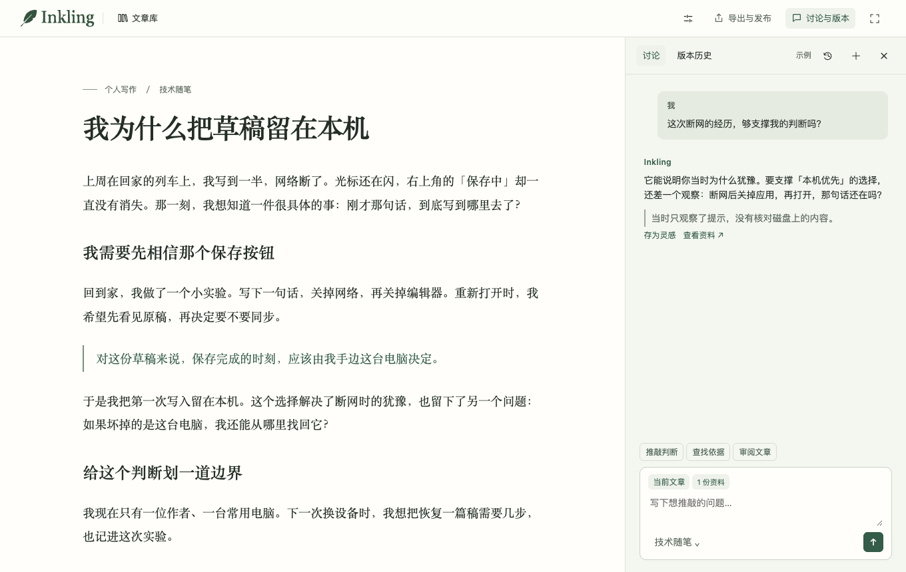
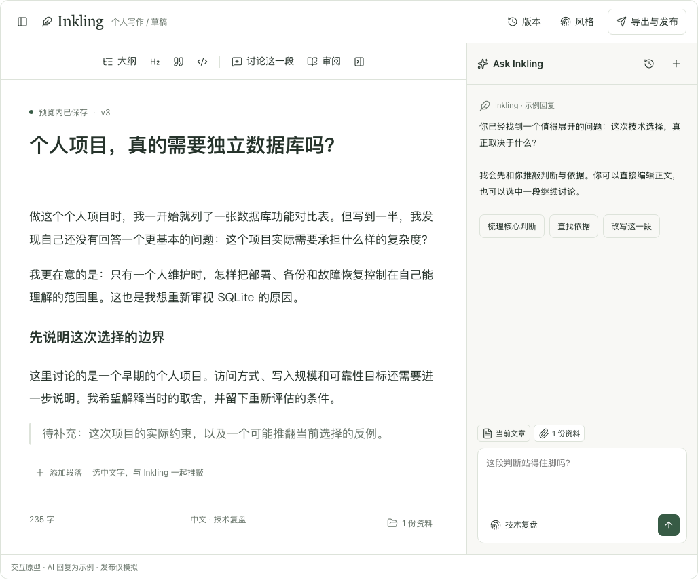

# Inkling 交互原型

## 当前版本 · 写作台 V3

[打开独立交互原型](inkling-writing-desk-v3.html) · [桌面截图](inkling-writing-desk-v3.png) · [V1 产品范围](../product/v1-scope.md)

2026-11-18。依据作者提供的 Claude V3 评审说明和 HTML 原型重新设计。首次打开直接回到《我为什么把草稿留在本机》和一段尚待验证的判断。右栏的示例讨论区分作者亲历的现象和仍然缺少的证据。作者可以留在稿纸上继续写，也可以沿引用回看摘记。

**先体验一次段落协作。** 在正文中拖选几个字，点「讨论这段」。输入框会标出选中的段落，再点「改写这段」可以直接编辑候选文字。回到稿纸改一句，旧候选会要求重新生成。点「采用修改」后回到历史，可以找回原稿。讨论和改写以所选文字所在的整段为单位。

| 写作者想做的事 | 入口 |
| --- | --- |
| 新建或切换文章、保存灵感、引用一份资料、调整结构 | 左上「文章库」的四个页签；整理结构得到候选章节，作者确认后加入大纲 |
| 推敲判断、查找依据、审阅和返回对应段落 | 右栏输入框上方的三个动作；资料与段落可从上下文查看或移除 |
| 回看讨论、更换文类、保存或撤回个人记忆 | 讨论标题栏的历史按钮、输入框下的文类按钮 |
| 命名、比较与恢复正文 | 右栏「版本历史」；勾选两个版本可并列查看，恢复旧稿会建立一个新版本 |
| 导出或发布 | 顶栏「导出与发布」可下载 Markdown，检查具体版本后可模拟发布和更新 |
| 专注写作、查看保存状态 | 顶栏专注按钮收起讨论，右上角可退出；保存状态中可下载当前稿件 JSON |

在文章库的「文章」页签中，「草稿」「已归档」「回收站」显示各自的篇数。归档适合暂时写完、以后仍要参考的稿件：归档后可只读查看正文及历史，点「移回草稿」继续写。移入回收站需要确认，随后可以恢复到移入前的位置。操作后列表会切到目的地，保留文章标题和恢复入口。

顶栏「文章库」在 Logo 下方展开左栏，再点一次收起。桌面宽屏允许文章库、稿纸和讨论并排。顶栏「讨论与版本」控制右栏，栏内可切换「讨论」和「版本历史」；讨论历史也在原栏中打开，返回后保留未发送的问题。窄屏优先展示最近打开的一栏，顶栏持续可用。风格、发布和操作确认使用对话框。[查看展开文章库的布局](inkling-writing-desk-v3-library.png)。原型是单个 HTML，包含样式、脚本和项目标识，可直接在本机浏览器打开。演示数据保存在该浏览器的本地存储，存储不可用时状态改为「仅本页」。讨论、研究和发布用样例演示，正式产品行为见 Living Spec。

在 Chromium 验证了段落引用、候选手改与过期保护、版本恢复、文章切换与刷新保留、资料勾选、记忆确认与撤回、发布确认、讨论中止与历史、专注及窄屏切换。检查了 320、375、768、1024、1360 像素宽度。以上是设计原型验证，C03 的真实输入法验收仍单独记录。

## 上一版 · V2

- [V2 独立预览](inkling-writing-partner-v2.html)：下载仓库后在浏览器中打开，无需启动 Inkling 服务。GitHub 文件页显示源代码，不直接运行原型。
- [V2 可编辑源文件](inkling-writing-partner-v2.source.html)：保存原始界面、示例数据和交互逻辑；独立预览是带运行包装的导出副本。
- [V1 功能范围](../product/v1-scope.md)：正式产品的范围与验收，以该文档为准。

### V2 交互设计

正文是默认工作区，右侧持续讨论；文章列表、大纲、资料、风格、版本和发布预览按需打开。研究、组织结构和审阅通过同一个 Chat 与快捷操作发起。专注写作可以收起 Chat，窄屏将正文与讨论上下排列。

| 场景 | 原型中的操作与反馈 |
| --- | --- |
| 推敲判断 | 编辑正文或选中内容，点击「讨论这一段」，在带上下文标记的 Chat 中继续讨论 |
| 修改表达 | 点击「改写这一段」，查看原文与候选，手改候选后接受或放弃；替换粒度为整段 |
| 保护作者编辑 | 候选生成后继续编辑正文，旧建议显示基线过期，需重新生成才能接受 |
| 收集依据 | 打开资料，选择讨论使用的材料，手工添加标题、摘记与来源链接 |
| 整理想法 | 打开大纲、保存回复为笔记，或从文章列表进入灵感与笔记并插入正文 |
| 风格与记忆 | 编辑风格说明、选择文类，明确保存示例经验，或撤回已保存记忆 |
| 找回过程 | 新建或恢复讨论，保存文章快照，比较版本并恢复旧内容 |
| 交付文章 | 查看 Markdown、复制内容，预览当前版本，演示建立草稿、确认发布和更新状态 |

建议体验顺序：修改正文 → 讨论与审阅 → 候选改写 → 版本比较 → 资料与风格 → 发布预览。

### V2 原型边界

AI 回复、研究结果和发布均使用示例状态，未连接模型、搜索或博客账号。资料链接是可访问入口，原型没有读取、核验网页。导出展示 Markdown 文本，不包含正式产品所需的 HTML 与附件包。

编辑器使用基础可编辑段落模拟交互，尚未接入正式编辑器；样文学习、精确选区替换、完整引用定位、跨文章检索、任务恢复、文件存储和备份属于后续实现。版本提供自动恢复点与手动快照，正式产品的自定义命名版本仍需补齐。

预览仅保留有限演示状态，可能因浏览器存储限制、清理数据或容量限制丢失；不用于保存真实稿件。仓库包含初始示例，不包含聊天预览中的个人编辑状态。独立预览使用导出包装提供样式和图标，部分资源可能需要联网；这不代表产品已具备离线运行能力。

### V2 检查记录

2026-11-16 已在本机 Chromium 预览中检查：候选接受、版本比较、过期建议保护、资料选择、风格保存、记忆保存与撤回、讨论历史、专注模式，以及模拟发布前的版本确认。

已检查浅色与深色桌面显示，以及 1024、650、320 像素浏览器视口下无工作台横向溢出；上述交互检查未发现页面脚本错误。这些结果仅证明原型交互可演示，不代表真实模型质量、中文输入法兼容性、数据可靠性或完整 V1 验收通过。

### V2 维护方式

修改可编辑源文件后重新导出独立预览，更新默认界面截图，并复查本页列出的关键交互。保留示例和模拟标记，不在原型中加入凭据或私人稿件。

本版独立预览由 visualize 1.0.103 的 `scripts/render.py` 从源文件生成；示例命令为 `python3 <skill-dir>/scripts/render.py <source.html> <preview.html> --title 'Inkling 写作工作台 V2' --force`。运行已导出的预览不需要该生成工具。
